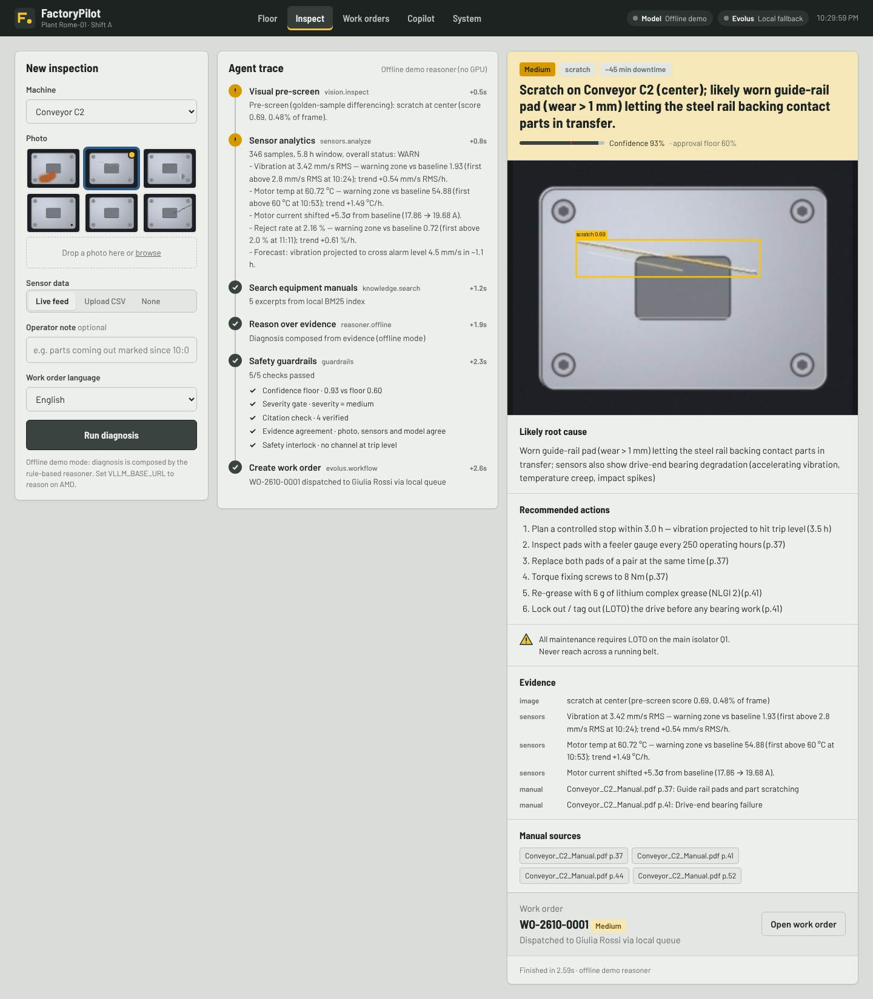
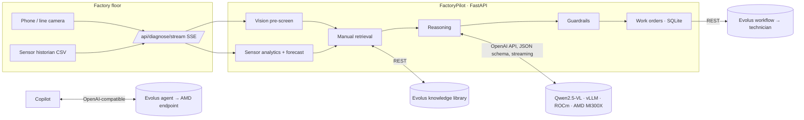

# FactoryPilot

**A photo and a sensor log in, a cited diagnosis and a dispatched work order out, in seconds.**

FactoryPilot is a maintenance agent for factory shift supervisors. It reads a photo of a part or machine together with the
last hours of sensor data, checks the equipment manuals, and decides what is wrong, how urgent it is and who should fix it.
Reasoning runs on an open vision-language model (Qwen2.5-VL) served by **vLLM on AMD Instinct MI300X with ROCm**. Work orders
and manual search run through **Evolus**.

AMD Developer Hackathon: ACT III · Track 1, Intelligent Industry · Evolus Business Agents track



## The problem

When a line starts making bad parts, the supervisor has to work out what is wrong from a photo, a sensor dashboard
and a long PDF manual, by hand. Meanwhile scrap piles up, and an early bearing fault turns into an unplanned stop. Maintenance knowledge is spread across PDFs, CMMS tickets and a few senior technicians.

## What FactoryPilot does

| Step | What happens | Where it runs |
|---|---|---|
| 1. Visual pre-screen | Golden-sample differencing (as in automated optical inspection stations) finds and classifies candidate defects: scratch, crack, corrosion, missing component, dent. Produces a heat-map overlay. | CPU, numpy/scipy |
| 2. Sensor analytics | Baseline vs recent shift (σ), robust spike detection, trend per hour, ISO 10816-3 vibration zones, and a quadratic forecast of **hours until alarm or trip**. | CPU, pandas |
| 3. Manual retrieval | Finds the relevant manual pages (with page numbers) for the defect and the sensor pattern. | **Evolus knowledge library** (local BM25 fallback) |
| 4. Reasoning | The VLM looks at the photo and the evidence, then returns a structured diagnosis (JSON schema-constrained): root cause, severity, calibrated confidence, ordered actions, safety notes and citations. Output is streamed. | **Qwen2.5-VL on AMD MI300X, vLLM + ROCm** |
| 5. Guardrails | Deterministic checks the model cannot override: confidence floor, critical-severity gate, **citation verification** (invented sources are removed), photo/sensor/model agreement, and a trip-level safety interlock. | CPU |
| 6. Action | Creates the work order, assigns a technician by skill, and dispatches it, or holds it for supervisor approval. | **Evolus workflow** (local queue fallback) |

Supervisors also get a live **Floor** view (health score, trends against manual limits, failure forecast), a **Work orders**
queue with one-click approval, and a **Copilot** that answers questions grounded in the live plant state and the manuals,
in any language. The Italian technician can ask in Italian.

## Why AMD

* **One MI300X (192 GB HBM3) serves the whole plant.** A 7B VLM leaves most of the memory free for the KV cache, so many
  inspections can run at once. The 72B model also fits on a single GPU when you want the strongest reasoning, without
  sharding.
* **Open model, own endpoint.** Plant photos and process data stay on infrastructure you control. Nothing is sent to a closed API.
* **Measured, not claimed.** Every model call records time to first token and decode tokens/s, which the **System** tab
  shows live. `infra/amd/bench.sh` runs `vllm bench serve` at concurrency 1 to 64, and its results show up in the same tab.

## Run it

### 1. Laptop, offline (no GPU, about 1 minute)

```bash
pip install -r requirements.txt
uvicorn app.main:app --port 7860          # open http://localhost:7860
```

With no `VLLM_BASE_URL` set, the agent runs end to end with an offline rule-based reasoner. It uses the same evidence,
guardrails and work orders, and the UI marks it as *Offline demo*. Docker works too: `docker compose up --build`.

### 2. With the model on AMD Developer Cloud

1. Create a GPU droplet with 1× MI300X and the **vLLM Quick Start** image. (Event access is through notebooks.amd.com/tokenfactory.)
2. Copy the scripts and start the model:
   ```bash
   scp infra/amd/*.sh root@<ip>:/root/ && ssh root@<ip>
   docker exec -it rocm bash
   export VLLM_API_KEY=$(openssl rand -hex 24); echo $VLLM_API_KEY   # keep it
   bash /root/start_vllm.sh && tail -f /tmp/vllm.log
   ```
3. On your laptop: `cp .env.example .env`, then set `VLLM_BASE_URL=http://<ip>:8000/v1` and `VLLM_API_KEY`.
4. Check the endpoint: `python scripts/check_endpoint.py`. It reports TTFT, single-stream tok/s and image + JSON mode.
5. Optional: run `bash /root/bench.sh` on the droplet and `scp root@<ip>:/tmp/bench/*.json docs/benchmarks/`.

**Live URL for judges:** run the app on the same droplet with
`VLLM_API_KEY=... bash infra/amd/deploy_app.sh`. It is then served at `http://<ip>:7860`.
To bring up the model and the app together on any ROCm machine: `docker compose --profile amd up -d`.

> The droplet bills while it exists, even when powered off. Destroy it when you're done.

### 3. Connect Evolus

See [docs/EVOLUS_SETUP.md](docs/EVOLUS_SETUP.md). In short: upload `data/manuals/*.md` to a knowledge library, create a
work-order workflow, connect your AMD vLLM endpoint as the workspace model, put the IDs in `.env`, then run
`python scripts/check_evolus.py`. The top bar shows how many Evolus building blocks are live, and the System tab logs every
API call.

## Demo flow (3 minutes)

See [docs/DEMO_SCRIPT.md](docs/DEMO_SCRIPT.md). In short:
**Floor** (Conveyor C2 is drifting toward alarm) → **Inspect C2** (scratch + bearing trend → dispatched work order) →
**Press P1 crack** (critical, so it is held for approval) → **Work orders** (approve) → **Copilot** (ask in Italian) →
**System** (AMD tokens/s, Evolus calls).

## Architecture



```
app/
  main.py        HTTP API + SSE streams          agent.py      the 6-step agent and guardrails
  vision.py      defect pre-screen + overlay     sensors.py    anomaly, trend, forecast, health score
  knowledge.py   Evolus library / BM25 fallback  reasoner.py   VLM prompt + JSON schema + offline reasoner
  llm.py         AMD vLLM client + telemetry     evolus.py     Evolus REST client (call log)
  workorders.py  lifecycle + dispatch            fleet.py      live plant simulation
  copilot.py     grounded Q&A                    simulate.py   failure-signature generator
static/          UI (vanilla JS, no build step, self-hosted fonts: works on an air-gapped plant network)
data/            manuals, sample photos, golden reference
infra/amd/       start_vllm.sh, bench.sh, deploy_app.sh
scripts/         check_endpoint.py, check_evolus.py, make_demo_images.py, make_sensor_logs.py
tests/           22 tests, including the AMD path against a fake streaming vLLM server
```

## API

| Method | Path | Purpose |
|---|---|---|
| POST | `/api/diagnose/stream` | multipart: `machine`, `image` or `sample`, `logs` or `live_logs`, `note`, `language` → Server-Sent Events trace |
| POST | `/api/diagnose` (alias `/diagnose`) | same inputs → final JSON |
| GET | `/api/fleet`, `/api/machines/{id}`, `/api/machines/{id}/log.csv` | live plant state |
| GET/POST | `/api/workorders`, `/api/workorders/{id}/{approve,reject,complete,reopen}` | work-order lifecycle |
| POST | `/api/copilot` | `{question, machine_id}` → SSE answer with sources |
| GET | `/api/status`, `/api/metrics` | backend health, AMD telemetry, benchmarks, Evolus call log |

Interactive docs at `/docs`.

## Responsible design

* The agent never hides uncertainty. Confidence is shown against the approval floor, and anything below it, anything
  critical, and any conflict between the photo and the sensors goes to a human.
* Citations are checked against what was actually retrieved, and unverifiable ones are removed and flagged.
* A sensor at trip level forces *stop now* and critical severity, whatever the model says.
* If the AMD endpoint is down, the agent falls back to the offline reasoner, caps confidence at 0.55, and asks for a human.

## Tests

```bash
pip install -r requirements-dev.txt && python -m pytest -q
```

## Data and licence

Sample photos are generated procedurally (`scripts/make_demo_images.py`) and sensor logs are simulated from physical
failure signatures (`app/simulate.py`), so the repo is free of licensing issues. Real MVTec AD images or historian
exports can be dropped in. Manuals in `data/manuals/` are fictional. Fonts: Barlow (SIL OFL). Code: MIT.
